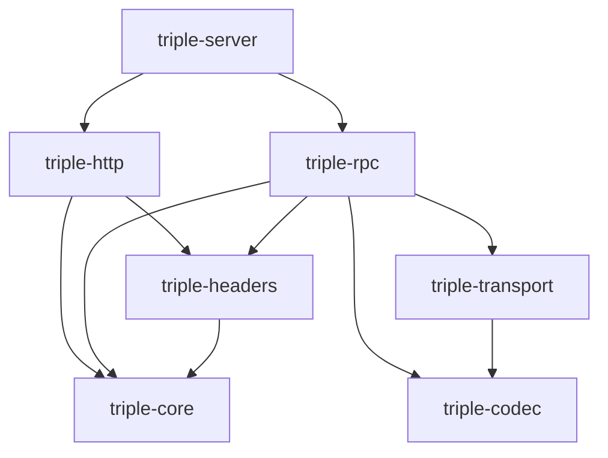

# Triple Architecture

The Dubbo Triple protocol is used by the Dubbo control plane. It supports HTTP unary calls, as well as Protobuf unary and streaming RPCs over HTTP/2.

## Request Handling

```mermaid
flowchart TD
    client["HTTP / gRPC Client"] --> server["triple-server<br/>TCP / TLS Connections<br/>HTTP/1.1 and HTTP/2 Detection"]
    server -->|Route by Content-Type| http["triple-http<br/>JSON / Protobuf Unary Calls"]
    server -->|Route by Content-Type| rpc["triple-rpc<br/>Protobuf Unary and Streaming RPCs"]
    http --> unary["UnaryHandler<br/>Business Logic"]
    rpc --> service["Service<br/>Business Logic"]
```

`triple-rpc::Client` provides the RPC client, using `triple-transport` to establish HTTP/2 connections.
The RPC server uses Hyper to drive connections. Both sides share message encoding and decoding logic and RPC call semantics.

## Module Dependencies

`http` builds on `core` and `headers` to implement the JSON / Protobuf unary call binding, handling request parsing, metadata processing, timeout enforcement, and response conversion.

`rpc` builds on these modules to implement Protobuf message processing, call dispatch, timeouts, and cancellation.
`core` defines shared semantics for paths, status codes and messages, metadata, and deadlines; `headers` handles protocol header and status conversion.
`transport` manages HTTP/2 client connections and bounded stream transport; `codec` handles message frame encoding and decoding.
